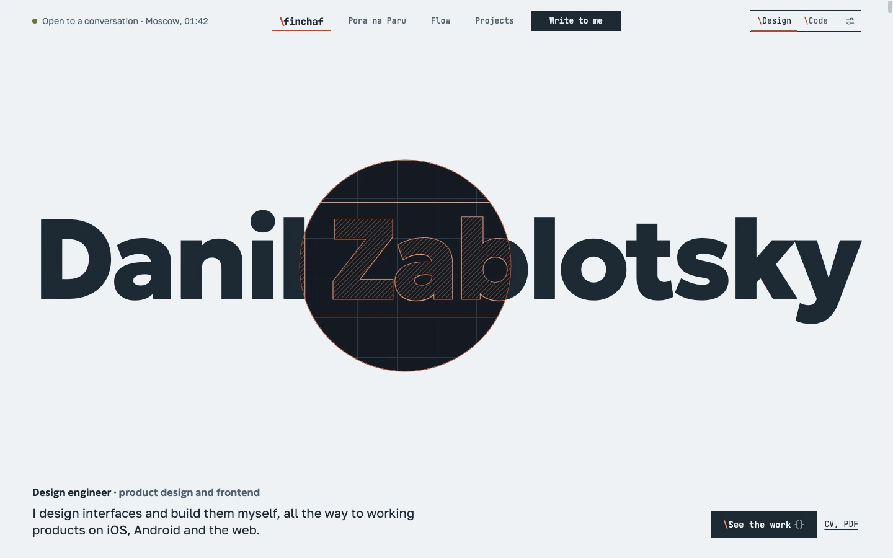
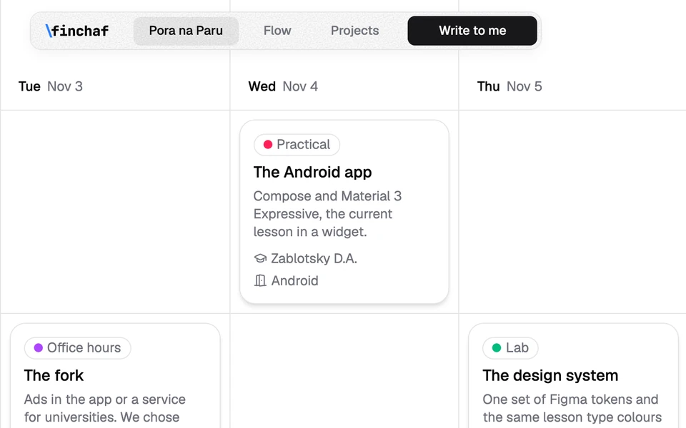
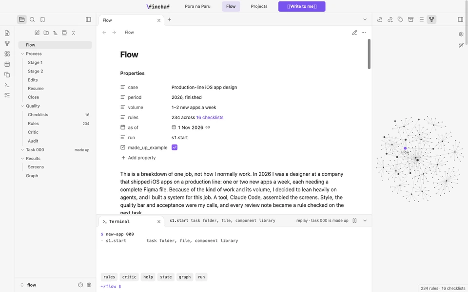
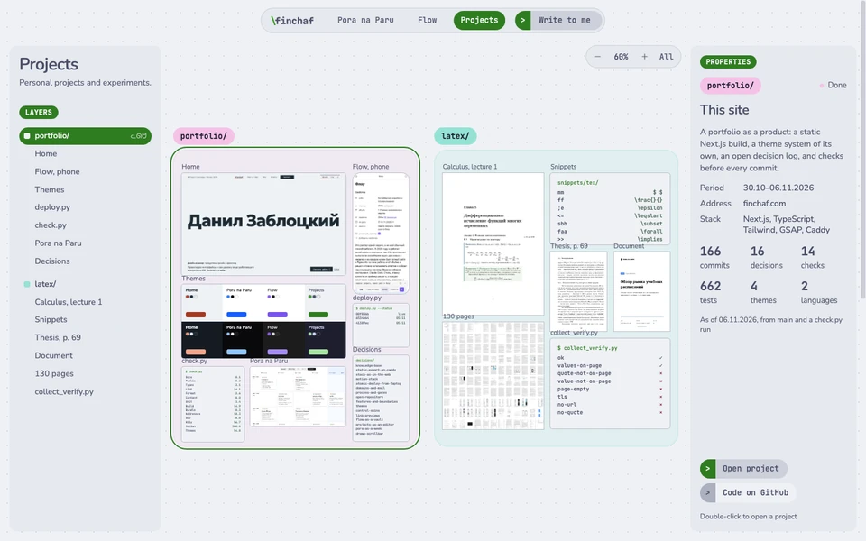
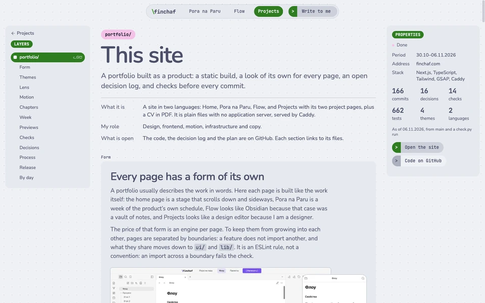

<picture>
  <source media="(prefers-color-scheme: dark)" srcset=".github/readme/home-dark.webp">
  
</picture>

# finchaf.com

The site of Danil Zablotsky, design engineer, and all of its code. Each page is built in the form of
the work it shows: a product as its own schedule, a case of agent work as a vault of notes, side
projects as a board in a design editor.

[](https://github.com/finchaf/portfolio/actions/workflows/gates.yml?query=branch%3Amain)
[](https://finchaf.com)
[](#licence)

<table>
  <tr>
    <td width="50%" valign="top">
      <a href="https://finchaf.com/en/poranaparu"><picture>
        <source media="(prefers-color-scheme: dark)" srcset=".github/readme/pora-dark.webp">
        
      </picture></a>
      <p><b><a href="https://finchaf.com/en/poranaparu">Pora na Paru</a></b><br>
      The product I co-founded, from idea to apps, laid out as a week of its own schedule. A lesson
      opens in its window, as it does in the product.</p>
    </td>
    <td width="50%" valign="top">
      <a href="https://finchaf.com/en/flow"><picture>
        <source media="(prefers-color-scheme: dark)" srcset=".github/readme/flow-dark.webp">
        
      </picture></a>
      <p><b><a href="https://finchaf.com/en/flow">Flow</a></b><br>
      A case study of the agent system I built for production-line iOS app design, as a vault of
      notes with a terminal that replays one task.</p>
    </td>
  </tr>
  <tr>
    <td width="50%" valign="top">
      <a href="https://finchaf.com/en/projects"><picture>
        <source media="(prefers-color-scheme: dark)" srcset=".github/readme/projects-dark.webp">
        
      </picture></a>
      <p><b><a href="https://finchaf.com/en/projects">Projects</a></b><br>
      A board in a design editor with two projects, this site and LaTeX. A double click opens
      each one as a page of its own.</p>
    </td>
    <td width="50%" valign="top">
      <a href="https://finchaf.com/en/projects/portfolio"><picture>
        <source media="(prefers-color-scheme: dark)" srcset=".github/readme/site-dark.webp">
        
      </picture></a>
      <p><b><a href="https://finchaf.com/en/projects/portfolio">This site</a></b><br>
      The long version of this README: themes, the lens, motion, the checks and the release, with
      live demos.</p>
    </td>
  </tr>
</table>

## How it is built

- **Static.** Next.js exports plain files, and Caddy serves them on a server shared with another
  product. There is no application server.
- **Stack.** Next.js 16, React 19, TypeScript, Tailwind CSS 4, next-intl and GSAP.
  Fonts come from Fontsource and are served from the site's own domain.
- **A page is a feature.** Each page lives in `src/features/<page>/` and never imports another. What two
  pages share moves down to `ui/`, `motion/`, `themes/`, `i18n/` or `lib/`. ESLint holds the boundary.
- **Themes.** A theme per page, 4 in all, on one contract of tokens, each in light and dark. The
  Tailwind palette is off, so a colour outside the contract does not build, and a test measures contrast.
- **Motion.** CSS for hover and focus, `ViewTransition` for the page change along the slash of the
  logo, GSAP for scenes on scroll, canvas for graphs. The first screen is in the HTML before any
  script, and every effect honours `prefers-reduced-motion`.
- **Two languages.** Russian and English. Every string lives in `messages/`, and a lint rule keeps
  text out of the markup.

## Where things are

| Path                                                                          | What it holds                                                                    |
| ----------------------------------------------------------------------------- | -------------------------------------------------------------------------------- |
| [`src/app/`](src/app)                                                         | Routes, the sitemap and robots: each page file hands over to its feature         |
| [`src/features/`](src/features)                                               | One folder per page: `home`, `flow`, `pora`, `projects`                          |
| [`src/shell/`](src/shell)                                                     | What every page wears: the capsule, the write sheet, the footer, the page change |
| [`src/ui/`](src/ui), [`src/motion/`](src/motion), [`src/themes/`](src/themes) | Shared components, motion tokens and scenes, the four themes                     |
| [`src/i18n/`](src/i18n), [`src/lib/`](src/lib)                                | Languages and addresses; the page registry and plain data                        |
| [`messages/`](messages)                                                       | Every string in Russian and English, and Flow's notes as Markdown                |
| [`e2e/`](e2e)                                                                 | The browser gates, in Playwright                                                 |
| [`scripts/`](scripts)                                                         | The gates, the preview, the release, the link pictures and the CV                |
| [`docs/`](docs/README.md)                                                     | The knowledge base: decisions, structure, design system, quality, plan           |

## Decisions

Whatever is expensive to undo is written down before the code, in [`docs/`](docs/README.md). The
docs are in Russian; this README is their English summary. There are 16
[records](docs/01-architecture/decisions/README.md) so far, among them:

| Question                     | Answer                                                                                                                         | Record                                                                   |
| ---------------------------- | ------------------------------------------------------------------------------------------------------------------------------ | ------------------------------------------------------------------------ |
| How does it run?             | A static export served by Caddy: the motion lives in the browser, a server would add risk and no ability                       | [0002](docs/01-architecture/decisions/0002-static-export-on-caddy.md)    |
| How does it ship?            | From a laptop, into a folder per release, then one switch of a symlink: no downtime, rollback in a second, no server key in CI | [0005](docs/01-architecture/decisions/0005-atomic-deploy-from-laptop.md) |
| How is quality held?         | One command runs every gate, and CI runs the same command                                                                      | [0007](docs/01-architecture/decisions/0007-process-and-gates.md)         |
| Why is it public?            | The way the site is built is part of the work; private material has lived elsewhere since the first commit                     | [0008](docs/01-architecture/decisions/0008-open-repository.md)           |
| How do pages look different? | A theme per page, two modes, one contract of tokens                                                                            | [0010](docs/01-architecture/decisions/0010-themes.md)                    |

## Checks

`python3 scripts/check.py` runs 14 gates: docs, a check that nothing private is published, types,
lint, format, content, unit tests, the build, the JavaScript budget of 280 KB a page, and five browser gates
against the build behind a real Caddy. CI runs the same command on every pull request. The run of
07.11.2026: 804 unit and 332 browser tests, all green.

## Working here

You need Node 26.11.1, pnpm 12.11.2, and Docker or Colima for the preview and the browser gates.

```sh
git config core.hooksPath .githooks
pnpm install
pnpm dev                    # http://localhost:3000
python3 scripts/check.py    # every gate
```

`pnpm build && pnpm preview` serves the build behind the same Caddy as production, on
<http://127.0.0.1:8090>.

Commits are signed [Conventional Commits](https://www.conventionalcommits.org/). `main` is linear and
moves only by fast-forward after green CI. A release is `python3 scripts/deploy.py` from `main`. The
[`.claude/`](.claude) folder holds the process for [Claude Code](https://claude.com/claude-code):
`/nt` starts a task, `/ar` audits it, `/si` lands it, `/rf` studies an effect on another site and
rewrites it from scratch.

## If something is wrong

A bug on the site goes to [Issues](https://github.com/finchaf/portfolio/issues), a question about how
something is built to [Discussions](https://github.com/finchaf/portfolio/discussions). A security
problem goes privately, as [SECURITY.md](SECURITY.md) says. The site is personal, so pull requests are
not taken; [CONTRIBUTING.md](CONTRIBUTING.md) says why and what helps instead.

## Licence

The code is [MIT](LICENSE). That covers code only: the texts, documents, case studies, images, video,
the logo and the visual design are © Danil Zablotsky, all rights reserved. Learn from it freely, and
please make your portfolio your own. [NOTICE](NOTICE) lists what stays reserved. GSAP is a dependency
under its own [licence](https://gsap.com/standard-license), not MIT.
